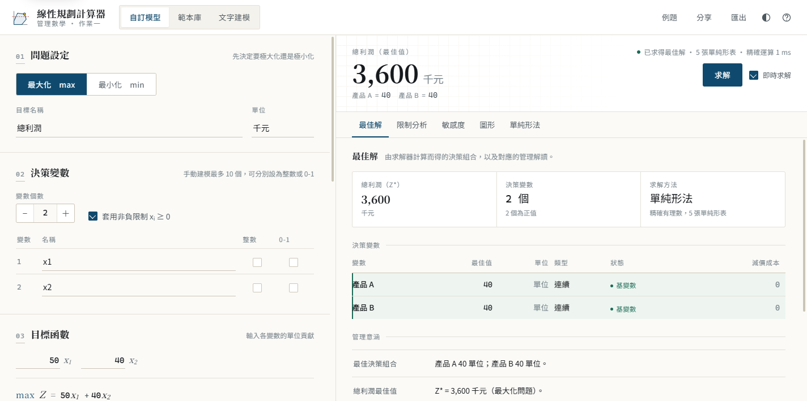

# 線性規劃計算器｜管理數學作業一

> 在瀏覽器裡建立線性規劃模型、精確求解、讀懂影子價格。
> 純 HTML／CSS／JavaScript，零框架、零外部依賴、離線可用。



---

## 快速開始

1. 解壓縮後直接**雙擊 `index.html`**（建議 Chrome 或 Edge，2024 以後的版本）。
2. 系統會自動載入一個已求解的例題；左側改係數，右側結果會即時更新。
3. 想從範本開始，點上方「範本庫」；想用一句話描述問題，點「文字建模」。

不需要安裝 Node、npm 或任何伺服器。若你的瀏覽器對 `file://` 有額外限制，也可以在本機起一個靜態伺服器：

```bash
# 在專案資料夾內（需要 Python）
python -m http.server 8000
# 然後開啟 http://localhost:8000
```

---

## 功能

### 基本功能（對應作業要求）

| 項目 | 說明 |
| --- | --- |
| 問題類型 | 最大化／最小化切換，數學模型同步重建 |
| 決策變數 | 1～10 個可命名變數，可個別標記「整數」或「0-1」 |
| 非負限制 | 預設套用 `xᵢ ≥ 0`，可取消（系統以自由變數拆分法處理可為負的變數） |
| 目標函數 | 係數即時排版成數學式，支援分數（`7/3`）與小數 |
| 限制式 | 多條限制式、`≤／=／≥`、右端值，可命名與刪除 |
| 模型顯示 | 自動排版 `max/min`、`subject to`、非負與整數條件 |
| 求解 | 兩階段單純形法；無可行解／無界解都有專屬說明與檢查建議 |
| 結果解讀 | 自動產生「最佳決策組合、瓶頸資源、餘裕資源、邊際價值」 |
| 限制式分析 | 左側值、右側值、鬆弛／盈餘、緊束狀態、影子價格 |
| 敏感度分析 | 影子價格、右端允許範圍、目標係數允許範圍（皆為精確值） |
| 圖形分析 | 兩變數問題：限制式、可行區域、頂點、最佳解、可拖動的等利潤線 |
| 教學輔助 | 單純形法逐張表格（含第一階段人工變數），可對照課本驗算 |

### 進階功能

- **管理科學範本庫**：運輸問題、指派問題、生產計劃。每個範本都走「資料輸入 → 自動建立模型 → 求解 → 結果分析」，
  運輸問題會自動處理供需不平衡（補虛擬列／欄），並以矩陣呈現最佳運輸方案。
- **文字建模**：把一段中文題目貼進去，離線規則引擎會抽取產品、單位貢獻、資源耗用與上限，
  並列出「找到了什麼」與自信度；解析結果可再回到表單修改。另支援速記格式：

  ```
  max
  利潤 30 50
  人力 2 3 <= 120
  原料 1 2 <= 80
  ```

- **整數規劃**：分支定界法，顯示 LP 鬆弛值、整數差距、搜尋節點數與分支紀錄。
- **匯出**：一頁式求解報告（可直接列印成 PDF）、模型 JSON（可再匯入）、CSV、分享連結。
- **其他**：深色模式、鍵盤快捷鍵、行動版底部摘要列、即時求解開關。

### 鍵盤快捷鍵

| 按鍵 | 功能 |
| --- | --- |
| `Ctrl` / `⌘` + `Enter` | 立即求解 |
| `1`～`6` | 切換結果分頁 |
| `E` | 開啟例題庫 |
| `T` | 切換深色模式 |
| `?` | 操作說明 |
| `Esc` | 關閉對話框 |

---

## 技術說明

### 為什麼用精確分數？

用浮點數實作單純形法時，影子價格很容易變成 `0.9999999` 或 `-2.3e-14`，看起來就像程式壞了。
本專案以 `BigInt` 分子／分母實作 `Fraction` 類別（`assets/js/fraction.js`），
樞紐運算全部是分數加減乘除，因此：

- 最佳解與影子價格是**精確值**（例如 `50/3`，而不是 16.6667）
- 敏感度的允許範圍也是精確邊界，不需要容差
- 退化（degenerate）情況不會累積誤差

### 求解流程（`assets/js/solver.js`）

1. **標準化**：最小化問題轉為最大化、右端負值翻轉不等號、自由變數拆分為兩個非負變數。
2. **第一階段**：加入人工變數，以「最小化人工變數總和」建立可行基；若最優值仍小於 0，判定無可行解。
3. **第二階段**：以原始目標函數求解；若某欄檢定數為正但所有係數皆 ≤ 0，判定無界解。
4. **敏感度**：由最終表中「初始基變數」的欄位取出 `B⁻¹`，再計算
   - 影子價格 `y = c_Bᵀ B⁻¹`
   - 右端允許範圍（維持基底可行的 Δb 區間）
   - 目標係數允許範圍（維持所有檢定數 ≤ 0 的 Δc 區間）
5. **整數規劃**：分支定界，對小數變數往「≤ 下界」「≥ 上界」分支，以目前最佳整數解剪枝。

### 圖形（`assets/js/graph.js`）

可行區域以**半平面裁切**（Sutherland–Hodgman）從視窗矩形逐步裁切得到多邊形；
限制式直線、頂點、等利潤線與最佳解都以 SVG 輸出，因此列印不掉畫質。

---

## 專案結構

```
LPCalculator/
├── index.html                 主畫面（單頁應用，無需建置）
├── assets/css/app.css         設計權杖、版面、深色模式、A4 列印樣式
├── assets/js/fraction.js      精確有理數（BigInt 分子／分母）
├── assets/js/solver.js        兩階段單純形法、敏感度分析、分支定界
├── assets/js/model.js         模型物件、驗證、數學式排版、管理意涵
├── assets/js/recipes.js       內建例題與三種管理科學範本
├── assets/js/parser.js        文字建模（自然語言規則引擎）
├── assets/js/graph.js         可行區域圖（SVG 半平面裁切）
├── assets/js/views.js         結果分頁、單純形表、列印報告
├── assets/js/app.js           狀態管理、事件綁定、匯出
├── tests/engine.test.js       求解引擎自我檢測（41 項）
└── docs/
    ├── 系統說明文件.pdf        5 頁系統說明（功能、流程、技術、架構、心得）
    ├── 系統說明文件.html       說明文件的 HTML 原始檔
    └── img/                   文件用截圖
```

### 資料流

```
表單輸入 → 模型物件（model.js） → 求解引擎（solver.js） → 結果物件 → 視圖（views.js / graph.js）
```

求解引擎完全不碰 DOM，因此可以直接用 Node.js 測試；視圖層也不做任何數學運算。

---

## 測試

```bash
node tests/engine.test.js
```

目前 **41 項全部通過**。測試不是「跑得動就好」，而是用**獨立方法**交叉驗證：

- 兩變數問題以頂點列舉法暴力求解，比對最佳解與最佳值
- 影子價格以「右端擾動 0.5 後重解」的差分回推
- 敏感度範圍以「邊界內外各自重解」驗證（範圍內斜率不變、範圍外改變）
- 整數規劃以暴力列舉（背包問題 2⁴ 種組合）驗證
- 運輸問題檢查總運輸量、供需平衡，並用成本矩陣重算目標值

涵蓋案例：無可行解、無界解、等式限制式、右端為負、自由變數、退化問題、多重最佳解。

---

## 已知限制

- 圖形分析僅支援**兩個決策變數**（三維以上請看代數結果）。
- 手動建模上限為 10 個變數、80 條限制式；範本模型可超過（運輸問題 3×4 為 12 個變數）。
- 文字建模是**規則式**引擎，只處理常見題型句型；解析結果一律回到可編輯表單，不假裝是萬能 AI。
- 敏感度分析為「一次只改一個參數」的局部資訊；同時變動多個參數時請以 100% 法則另行判斷。

---

## 授權與致謝

本專案為管理數學課程作業，可自由參考與修改。
求解演算法依課堂講義與標準作業研究教材實作；介面字型使用系統內建的 Noto Sans TC／Noto Serif TC。
